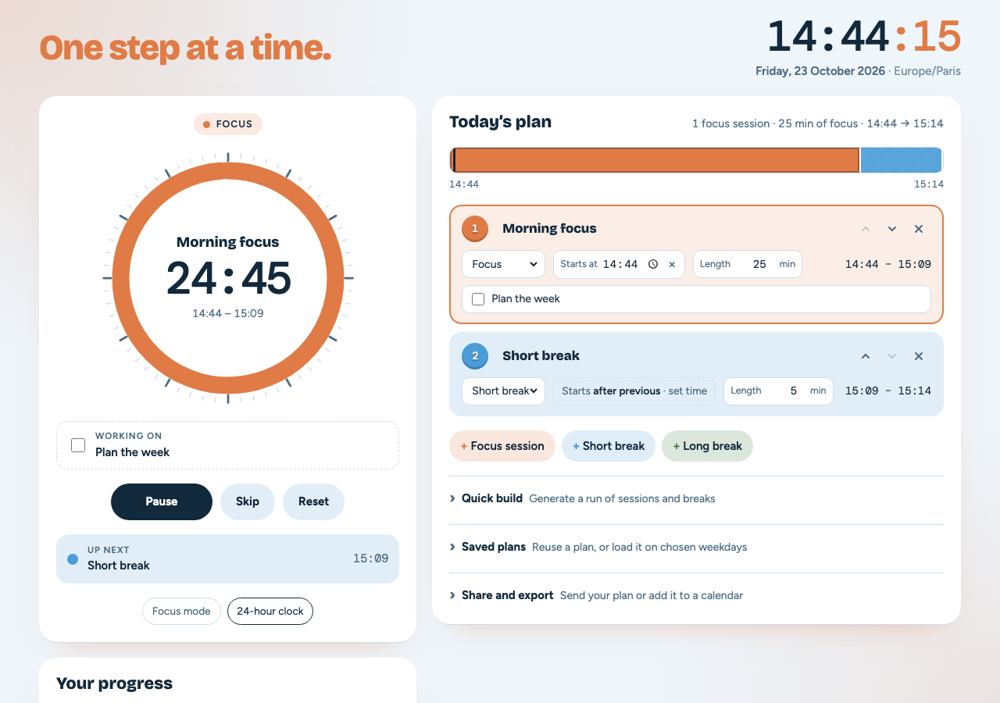

# Focus Timer

A colourful pomodoro-style timer that runs on the clock. Plan as many focus sessions and breaks as you like, pin any of them to a real start time (for example, lunch at 13:00), and the timer follows your plan through the day. A live clock shows the current date and time to the second, and a line of encouragement at the top changes as you work.

**Live page:** `https://dayolabi.github.io/Timer/`

## Features

**Planning**
- **Unlimited sessions and breaks.** Each block has a name, a type (Focus, Short break or Long break), a colour and a length.
- **Clock-time scheduling.** Pin a block to a start time, or let it start as soon as the one before it ends.
- **Task notes.** Write what you'll work on in each focus session. It shows under the dial while the session runs, and you can tick it off when you're done.
- **Quick build** generates a standard run, such as 4 × 25-minute sessions with 5-minute breaks and a long break every 4 sessions.
- **Saved plans.** Save the current plan under a name like "Workday" and load it again with one click.
- **Weekday repeats.** Pick days on a saved plan, and it loads automatically the first time you open the page on those days.
- **Clear all** with a confirmation step. Clearing, deleting and replacing can all be undone for 8 seconds.

**While it runs**
- **Countdown dial** that empties as the current block runs, showing what comes next and when.
- **Timeline strip** that shows the whole plan in colour, with a marker for the current time.
- **Auto-start** begins the plan at the first block's clock time, without pressing Start.
- **Alert sounds:** chime, bell, soft beep or spoken words, with a volume control.
- **Warning before a block ends:** a soft double tick 1, 2 or 5 minutes before the end.
- **Focus mode** hides everything except the dial, the clock and your task, and goes full screen.
- **Countdown in the tab icon**, so you can see progress from another tab.
- Desktop alerts when the tab is in the background, and confetti when the plan is finished.

**Progress and motivation**
- **Today's numbers:** sessions completed, total focus time and your day streak.
- **7-day chart** of focus time. Hover over or tap a bar to see that day's details.
- **Rotating encouragement**, such as "You can do it." and "Keep it up." During breaks it switches to rest messages, and you can add your own.

**Sharing and apps**
- **Share link.** Copy a link that carries your plan. Anyone who opens it can load their own copy.
- **Calendar export.** Download an `.ics` file to add the plan to Google Calendar, Outlook or Apple Calendar.
- **Install as an app** on a phone or computer. It works offline once installed.

New visitors start with an empty plan. Everything is saved in your own browser, so a page reload doesn't lose your plan, even with the timer running.

## How to use it

1. **Build your plan.** Add blocks with **Focus session**, **Short break** or **Long break**, open **Quick build**, or load one of your **Saved plans**.
2. **Set the times.** In each block you can:
   - click the name to rename it
   - change the type from the drop-down
   - click the numbered circle to change the colour (Shift-click goes backwards)
   - set the length in minutes
   - click **Starts after previous · set time** to pin the block to a clock time, or click **×** to unpin it
   - type a task in a focus session, and tick it when it's done
   - use the arrows to reorder the block and **×** to delete it
3. **Press Start**, or turn on **Start automatically** in Settings. If the first block is pinned to a later time, the timer waits and counts down to it.
4. While it runs, use **Pause / Resume**, **Skip** (jump to the next block) and **Reset** (stop the run and keep the plan).

**Keyboard shortcuts:** Space starts and pauses. F turns focus mode on and off. Esc leaves focus mode.

### How scheduling works

| Situation | What happens |
| --- | --- |
| A block is pinned to a clock time | It starts at exactly that time. |
| A block is set to "after previous" | It starts the moment the block before it ends. |
| A block's length is left empty | It runs until the next pinned block starts. |
| A block would run past the next pinned start | It's cut short, and the plan shows a warning. |
| A block ends before the next pinned start | The gap shows as **Free time**, with a countdown. Press **Start now** to begin the next block early. |
| You pause | Blocks set to "after previous" move back by the length of the pause. Pinned blocks stay where they are. |

Clock times are matched to the nearest occurrence within 12 hours, so a plan that runs past midnight works as expected.

### How progress is counted

A focus session counts as completed once you've spent at least half of its planned length in it, whether it runs to the end or you skip it. Focus time counts every minute the timer runs during a focus session, and pauses don't count. Your streak is the number of days in a row with at least one completed session.

## Files

| File | Purpose |
| --- | --- |
| `index.html` | Page structure |
| `styles.css` | Colours, layout, light and dark themes, focus mode |
| `app.js` | Clock, scheduling, timer, plan editor, saved plans, progress, sounds, sharing and export |
| `sw.js` | Offline support for the installed app |
| `manifest.webmanifest` | App name, colours and icons for installing |
| `favicon.svg`, `favicon.png` | Clock icon for the browser tab and iPhone home screen |
| `icon-192.png`, `icon-512.png`, `icon-maskable-512.png` | App icons for Android, Chrome and Edge |
| `screenshot.png` | Image used in this README |

## Browser notes

- **Sound** only plays after you've clicked something on the page, because browsers block audio until then. This also applies to auto-start: click anywhere on the page once after opening it.
- **Auto-start and weekday repeats** only work while the page is open. A web page can't wake itself up once it's closed.
- **Phones** may pause the page in the background. Keep it on screen, or use focus mode, for reliable timing.
- **Desktop alerts** need you to click **Allow** the first time you press Start. They only appear when the tab is in the background.
- **Saved data** (plans, saved plans, progress and settings) lives in each browser's local storage. It isn't shared between devices or people, and clearing your browser data removes it. Use a share link to move a plan to another device.
- **Installing:** in Chrome or Edge, use **Install as an app** in Settings or the install icon in the address bar. On iPhone or iPad, tap **Share**, then **Add to Home Screen**.
- The screen stays awake during a run in browsers that support it.

## Credits

Fonts: [Bricolage Grotesque](https://fonts.google.com/specimen/Bricolage+Grotesque), [Figtree](https://fonts.google.com/specimen/Figtree) and [DM Mono](https://fonts.google.com/specimen/DM+Mono), from Google Fonts.
